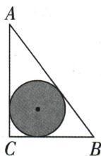

<!-- question-source:start -->
7[中]如图, $\triangle ABC$ 是一个小型花园, 阴影部分为花园中的一个圆形水池, 且与 $\triangle ABC$ 三边相切, 已知 $AB = 5 \mathrm{~m}, AC = 4 \mathrm{~m}, BC = 3 \mathrm{~m}$ . 若从天空飘落一片树叶恰好落入花园

里,则落入水池的概率为\_\_\_\_(π取3).
<!-- question-source:end -->

![[Q00107066A1]]
