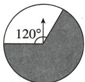
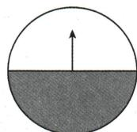

<!-- question-source:start -->
8[2025 浙江杭州质检, 中] 如图, A、B 是两个可以自由转动的转盘, A 转盘白色扇形和黑色扇形的圆心角度数分别为 $120^{\circ}$ 和 $240^{\circ}$ , B 转盘被分成面积相等的黑、白扇形, 转动 A、B 转盘各一次, 两次指针都落在黑色区域的概率为 \_\_\_\_.

A

B
<!-- question-source:end -->

![[Q00107067A1]]
