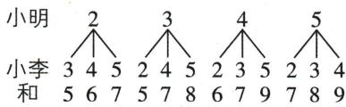

> [!success]- 必刷题
>
> > [!success] **【答案】** B
>
> > [!note]- **【解析】**
> > 画树状图如下：
> >
> > 
> >
> > ## 刷有所得
> >
> > 使用列表法求解放回型、不放回型概率问题时，“放回型”对角线有数值，“不放回型”对角线无数值.
> >
> > ## 关键点拨
> >
> > 画出树状图得出所有等可能的情况数, 找出点 $(a,b)$ 在直线 y=x-1 上的情况数, 即可得出所求概率.
> >
> > 共有 12 种等可能的结果, 小明获胜的结果有 4 种, ∴ 小明获胜的概率为 $\frac{4}{12} = \frac{1}{3}$ ,
> >
> > 故选 **B**.
