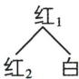
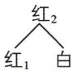
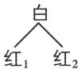
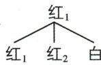
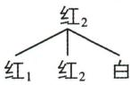
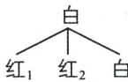

> [!success]- 必刷题
>
> > [!success] **【答案】** <
>
> > [!note]- **【解析】**
> > 活动 1: 画树状图如下:
> >
> > 
> >
> > 
> >
> > 
> >
> > 共有6种等可能的结果,其中摸出的两个球都是红球的结果有2种, $\therefore P_{1}=\frac{2}{6}=\frac{1}{3}$ ;
> >
> > 活动 2: 画树状图如下:
> >
> > 
> >
> > 
> >
> > 
> >
> > 共有9种等可能的结果,其中两次摸出的球都是红球的结果有4种, $\therefore P_{2}=\frac{4}{9},\therefore P_{1}<P_{2}$ .故答案为<.
