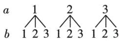

> [!success]- 必刷题
>
> > [!success] **【答案】** C
>
> > [!note]- **【解析】**
> > 画树状图如下：
> >
> > 
> >
> > 所有等可能的情况有9种,其中点 $(a,b)$ 在直线y=x-1上的情况有2种,所以点 $(a,b)$ 在直线y=x-1上的概率为 $\frac{2}{9}$ .
> >
> > 故选 **C**.
