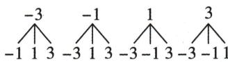

> [!success]- 必刷题
>
> > [!success] **【答案】** $\frac{5}{6}$
>
> > [!note]- **【解析】**
> > $x^{2} - 2x - 3 = 0, \therefore (x - 3)(x + 1) = 0,$ 则 $x - 3 = 0$ 或 $x + 1 = 0$ , 解得 $x_{1} = 3, x_{2} = -1$ . 画树状图如下：
> >
> > 
> >
> > 共有 12 种等可能的结果, 其中所抽卡片上的数字至少有一个是方程 $x^{2}-2x-3=0$ 的解的结果有 10 种, ∴ 所抽卡片上的数字至少有一个是方程 $x^{2}-2x-3=0$ 的解的概率为 $\frac{10}{12}=\frac{5}{6}$ . 故答案为 $\frac{5}{6}$ .
