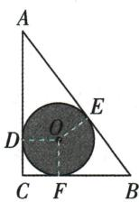

> [!success]- 必刷题
>
> > [!success] **【答案】** $\frac{1}{2}$
>
> > [!note]- **【解析】**
> > 如图, 设圆形水池与 $\triangle ABC$ 三边的切点分别为 $D, E, F$ , 圆形水池的圆心为 $O$ , 连接 $OD, OF, OE$ . 设 $CF = CD = x \mathrm{~m}$ , 则 $AD = AE = AC - DC = (4-$
> >
> > 
> >
> > $x)\mathrm{m},BF = BE = BC - CF = (3 - x)\mathrm{m}.$ 由 $AB = AE+$ $BE$ ，得 $(4 - x) + (3 - x) = 5$ ，解得 $x = 1.\because AC^2 +$ $BC^2 = 4^2 +3^2 = 25 = 5^2 = AB^2,\therefore \triangle ABC$ 是直角三角形，且 $\angle ACB = 90^{\circ}.\because D,F$ 分别是圆 $O$ 与边 $AC,BC$ 相切的切点，∴ $\angle ODC = \angle OFC = 90^{\circ}$ $OD = OF,\therefore$ 四边形DOFC是正方形，∴ $OD=$ $CF = 1\mathrm{m},\therefore S_{\text{圆} O} = \pi \times 1^{2}\approx 3(\mathrm{m}^{2}).$ 又 $\because S_{\triangle ABC}=$ $\frac{1}{2} AC\times BC = \frac{1}{2}\times 4\times 3 = 6(\mathrm{m}^2),\therefore$ 落入水池的概率为 $\frac{3}{6} = \frac{1}{2}$ ，故答案为 $\frac{1}{2}$
> >
> > 归纳总结
> > 通过大量重复试验,可以用随机事件发生的频率来估计该事件发生的概率.
