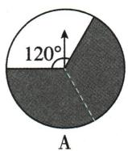
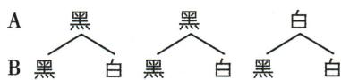

> [!success]- 必刷题
>
> > [!success] **【答案】** $\frac{1}{3}$
>
> > [!note]- **【解析】**
> > 如图, 把 A 转盘上的黑色扇形等分成两份.
> >
> > 
> >
> > 画树状图如下：
> >
> > 
> >
> > 共有6种等可能的结果,其中两次指针都落在黑色区域的结果有2种,∴两次指针都落在黑色区域的概率为 $\frac{2}{6}=\frac{1}{3}$ .故答案为 $\frac{1}{3}$ .
> >
> > ## 25.3 用频率估计概率
