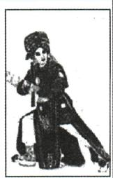
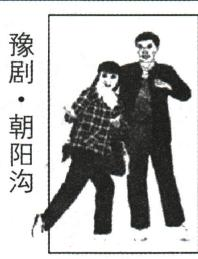

<!-- question-source:start -->
2[2024 河南中考]豫剧是国家级非物质文化遗产,因其雅俗共赏,深受大众喜爱.正面印有豫剧经典剧目人物的三张卡片如图所示,它们除正面外完全相同.把这三张卡片背面朝上洗匀,从中随机抽取一张,放回洗匀后,再从中随机抽取一张,两次抽取的卡片正面相同的概率为()

豫剧·花木兰豫剧·七品芝麻官

A. $\frac{1}{9}$ B. $\frac{1}{6}$ C. $\frac{1}{5}$ D. $\frac{1}{3}$
<!-- question-source:end -->

![[Q00107096A1]]
