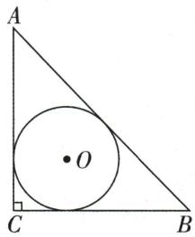

<!-- question-source:start -->
3[2024 山东滨州中考]刘徽(今山东滨州人)是魏晋时期我国伟大的数学家,中国古典数学理论的奠基者之一,被誉为“世界古代数学泰斗”.刘徽在注释《九章算术》时十分重视一题多解,其中最典型的是勾股容方和勾股容圆公式的推导,他给出了内切圆直径的多种表达形式.如图,Rt△ABC中,∠C=90°,AB,BC,CA的长分别为c,a,b.则可以用含c,a,b的式子表示出△ABC的内切圆直径d,下列解析式错误的是()

A. $d = a + b - c$ $\mathrm{B}.d = \frac{2ab}{a + b + c}$ C. $d = \sqrt{2(c - a)(c - b)}$ D. $d = |(a - b)(c - b)|$
<!-- question-source:end -->

![[Q00107097A1]]
