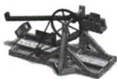
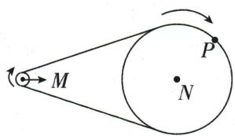

<!-- question-source:start -->
4[2024甘肃兰州中考]“轮动发石车”是我国古代的一种投石工具,在春秋战国时期被广泛应用,图(1)是陈列在展览馆的仿真模型. 图(2)是模型驱动部分的示意图,其中 $\odot M$ , $\odot N$ 的半径分别是1 cm和10 cm,当 $\odot M$ 顺时针转动3周时, $\odot N$ 上的点P随之旋转 $n^{\circ}$ ,则 $n=$ \_\_\_\_.

图(1)

图(2)
<!-- question-source:end -->

![[Q00107098A1]]
