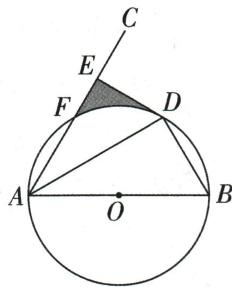

<!-- question-source:start -->
9[2023 江苏宿迁中考](1)如图,AB 是 $\odot O$ 的直径,AC 与 $\odot O$ 交于点 F,弦 AD 平分 $\angle BAC$ ,点 E 在 AC 上,连接 DE,DB,\_\_\_\_.求证:\_\_\_\_.
从①DE 与 $\odot O$ 相切；② $DE \perp AC$ 中选择一个作为已知条件，余下的一个作为结论，将题目补充完整（填写序号），并完成证明过程.

(2) 在(1)的前提下, 若 $AB = 6, \angle BAD = 30^{\circ}$ , 求阴影部分的面积.

<!-- question-source:end -->

![[Q00107103A1]]
