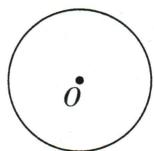

<!-- question-source:start -->
10[2023 黑龙江绥化中考节选]已知: 点 P 是 $\odot O$ 外一点. 尺规作图: 如图, 过点 P 作出 $\odot O$ 的两条切线 PE, PF, 切点分别为点 E, 点 F. (保留作图痕迹, 不要求写作法和证明)

<!-- question-source:end -->

![[Q00107104A1]]
