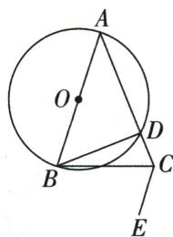

<!-- question-source:start -->
11[2023 江苏连云港中考]如图, 在 $\triangle ABC$ 中, AB = AC, 以 AB 为直径的 $\odot O$ 交边 AC 于点 D, 连接 BD, 过点 C 作 CE // AB.

(1)请用无刻度的直尺和圆规作图:过点 B 作 $\odot O$ 的切线,交 CE 于点 F;(不写作法,保留作图痕迹,标明字母)

(2) 在 (1) 的条件下, 求证: $BD = BF$ .

<!-- question-source:end -->

![[Q00107105A1]]
