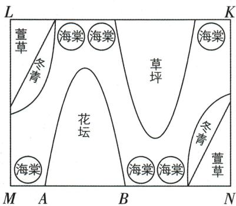
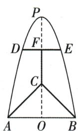

<!-- question-source:start -->
13[2024 山西中考]综合与实践

问题情境:如图(1),矩形 MNKL 是学校花园的示意图,其中一个花坛的轮廓可近似看成由抛物线的一部分与线段 AB 组成的封闭图形,点 A,B 在矩形的边 MN 上.现要对该花坛内种植区域进行划分,以种植不同花卉,学校面向全体同学征集设计方案.

方案设计:如图(2),AB=6米,AB的垂直平分线与抛物线交于点P,与AB交于点O,点P是抛物线的顶点,且PO=9米.欣欣设计的方案如下:

第一步:在线段 OP 上确定点 C,使 $\angle ACB = 90^{\circ}$ ,用篱笆沿线段 AC,BC 分隔出 $\triangle ABC$ 区域,种植串串红;

第二步: 在线段 CP 上取点 F(不与 C, P 重合), 过点 F 作 AB 的平行线, 交抛物线于点 D, E. 用篱笆沿 DE, CF 将线段 AC, BC 与抛物线围成的区域分隔成三部分, 分别种植不同花色的月季.

方案实施: 学校采用了欣欣的方案, 在完成第一步 $\triangle ABC$ 区域的分隔后, 发现仅剩 6 米篱笆材料. 若要在第二步分隔中恰好用完 6 米材料, 需确定 DE 与 CF 的长. 为此, 欣欣在图(2)中以 AB 所在直线为 x 轴, OP 所在直线为 y 轴建立平面直角坐标系. 请按照她的方法解决问题:

(1) 在图(2)中画出坐标系, 并求抛物线的函数解析式;

(2) 求 6 米材料恰好用完时 DE 与 CF 的长;

(3)种植区域分隔完成后,欣欣又想用灯带对该花坛进行装饰,计划将灯带围成一个矩形.她尝试借助图(2)设计矩形四个顶点的位置,其中两个顶点在抛物线上,另外两个顶点分别在线段AC,BC上.直接写出符合设计要求的矩形周长的最大值.

图(1)

图(2)

<!-- question-source:end -->

![[Q00107279A1]]
