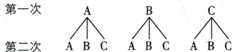

> [!success]- 必刷题
>
> > [!success] **【答案】** D
>
> > [!note]- **【解析】**
> > 把 3 张卡片分别记为 A, B, C, 画树状图如下:
> >
> > 
> >
> > 由图可知,共有9种等可能的结果,其中两次抽取的卡片正面相同的结果有3种,∴两次抽取的卡片正面相同的概率为 $\frac{3}{9}=\frac{1}{3}$ .
> >
> > 故选 **D**.
