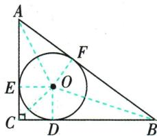

> [!success]- 必刷题
>
> > [!success] **【答案】** D
>
> > [!note]- **【解析】**
> > 如图, 设 $\odot O$ 与 $\triangle ABC$ 相切于点 D, E, F, 连接 OE, OD, OF, OA, OB, OC, 则 AE = AF, BD =
> >
> > $BF, EC = CD, OE \perp AC, OF \perp AB, OD \perp BC,$ 易证四边形OECD是正方形，设 $OE = OD = OF = r,$ 则 $EC = CD = r, \therefore AE = AF = b - r, BD = BF = a - r. \because AF +$
> >
> > 
> >
> > $BF=AB,\therefore b-r+a-r=c,\therefore r=\frac{a+b-c}{2},\therefore d=a+b-c,$ 故选项 A 正确. $\because S_{\triangle ABC}=S_{\triangle BOC}+S_{\triangle AOC}+S_{\triangle AOB},\therefore\frac{1}{2}ab=\frac{1}{2}ar+\frac{1}{2}br+\frac{1}{2}cr,\therefore ab=r(a+b+c),\therefore r=\frac{ab}{a+b+c},$ 即$d=\frac{2ab}{a+b+c}$ ，故选项 B 正确. $\because d=a+b-c, a^{2}+b^{2}=c^{2}$ $\therefore d^{2}=(a+b-c)^{2}=(a+b)^{2}-2c(a+b)+c^{2}=a^{2}+2ab+b^{2}-2ac-2bc+c^{2}=2c^{2}+2ab-2ac-2bc=2(c^{2}+ab-ac-bc)=2[c(c-a)-b(c-a)]=2(c-a)(c-b),\therefore d=\sqrt{2(c-a)(c-b)}$ ，故选项 C 正确. 排除法可知选项 D 错误.
> >
> > 故选 **D**.
