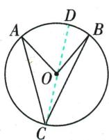
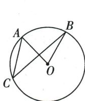
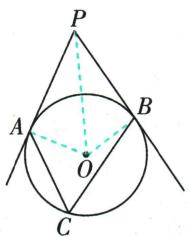

> [!success]- 必刷题
>
> > [!success] **【答案】** 详见解析
>
> > [!note]- **【解析】**
> > 【解】(1)其他两种情况如图(1)和图(2).若选择“圆心O在∠C的内部”这种情况,如图(1),连接CO,并延长交⊙O于点D.∵OA=OC=OB,
> > ∴∠A=∠ACO,∠B=∠BCO.∵∠AOD=∠A+
> > ∠ACO=2∠ACO,∠BOD=∠B+∠BCO=2∠BCO,
> > ∴∠AOB=∠AOD+∠BOD=2∠ACO+2∠BCO=
> > 2∠ACB,∴∠ACB= $\frac{1}{2}$ ∠AOB.(选择不唯一,证法不唯一)
> > (2)如图(3),连接OA,OB,OP.∵∠C=60°,
> > ∴∠AOB=2∠C=120°.∵PA,PB分别与⊙O相切于点A,B,∴∠OAP=∠OBP=90°,∴∠APO=
> > ∠BPO= $\frac{1}{2}$ ∠APB= $\frac{1}{2}$ (180°-120°)=30°.∵OA=
> > 2,∴OP=2OA=4,∴PA= $\sqrt{OP^{2}-OA^{2}}$ = $\sqrt{4^{2}-2^{2}}$ = $2\sqrt{3}$ .
> >
> > 
> >
> > 
> > 图(1)
> >
> > 
> > 图(2)
> > 图(3)
