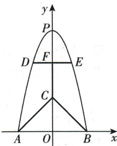

> [!success]- 必刷题
>
> > [!success] **【答案】** 详见解析
>
> > [!note]- **【解析】**
> > 【解】(1)建立平面直角坐标系如图(1)所示.
> > ∵ OP 所在直线是 AB 的垂直平分线, 且 AB = 6, ∴ OA = OB = $\frac{1}{2}AB = \frac{1}{2} \times 6 = 3$ , ∴ 点 B 的坐标为 $(3,0)$ . ∵ OP = 9, ∴ 点 P 的坐标为 $(0,9)$ .
> >
> > 
> > 图(1)
> >
> > ∵ 点 P 是抛物线的顶点，
> > ∴ 设抛物线的函数解析式为 $y=ax^{2}+9$ .
> > ∵ 点 B(3,0) 在抛物线 $y=ax^{2}+9$ 上，
> > ∴ $9a+9=0, \therefore a=-1,$ ∴ 抛物线的函数解析式为 $y = -x^{2} + 9 (-3 \leqslant x \leqslant 3)$ .
> > (2)∵ 点 D, E 在抛物线 $y = -x^{2} + 9$ 上，
> > ∴ 设点 E 的坐标为 $(m, -m^{2} + 9)$ .
> >
> > ∵ DE∥AB，交 y 轴于点 F，
> > ∴ DF = EF = m, $OF = -m^{2} + 9$ , ∴ DE = 2m.
> > ∵ 在 Rt△ABC 中，∠ACB = 90°, OA = OB, ∴ OC = $\frac{1}{2}AB = \frac{1}{2} \times 6 = 3$ , ∴ CF = OF - OC = $-m^{2} + 9 - 3 = -m^{2} + 6$ .
> > ∵6米材料恰好用完，∴ DE+CF=6, ∴ $-m^{2}+6+2m=6$ ，解得 $m_{1}=2, m_{2}=0$ （不符合题意，舍去），∴ m=2, ∴ DE=2m=4, $CF=-m^{2}+6=2$ .
> > 答: DE 的长为 4 米, CF 的长为 2 米.
> >
> > (3) $\frac{33}{2}$ 米.
> >
> > ## 期末综合测试
