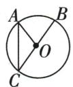
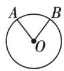
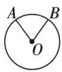
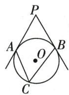

## 中考新考向备训

考向解读 教育部发布的《关于加强初中学业水平考试命题工作的意见》中指出:试题命制既要注重考查基础知识、基本技能,还要注重考查思维过程、创新意识和分析问题、解决问题的能力.结合不同学科特点,合理设置试题结构,减少机械记忆试题和客观性试题比例,提高探究性、开放性、综合性试题比例,积极探索跨学科命题.结合《义务教育数学课程标准(2022年版)》新变化,通过分析全国百余套中考试题,发现以传统文化为背景的试题,以及探究性、开放性、综合性、跨学科试题比例在中考试题中出现得越来越频繁,故精选部分试题,让学生感受考向变化.

## - 新考向 1 传统文化 •

![[初中/课堂同步/教辅/必刷题/2026版《初中必刷题》数学 RJ 9上/98_中考新考向备训/中考新考向备训/questions/Q00107095.md]]
![[初中/课堂同步/教辅/必刷题/2026版《初中必刷题》数学 RJ 9上/98_中考新考向备训/中考新考向备训/questions/Q00107096.md]]
![[初中/课堂同步/教辅/必刷题/2026版《初中必刷题》数学 RJ 9上/98_中考新考向备训/中考新考向备训/questions/Q00107097.md]]
![[初中/课堂同步/教辅/必刷题/2026版《初中必刷题》数学 RJ 9上/98_中考新考向备训/中考新考向备训/questions/Q00107098.md]]
![[初中/课堂同步/教辅/必刷题/2026版《初中必刷题》数学 RJ 9上/98_中考新考向备训/中考新考向备训/questions/Q00107099.md]]

## - 新考向 2 跨学科综合 •

![[初中/课堂同步/教辅/必刷题/2026版《初中必刷题》数学 RJ 9上/98_中考新考向备训/中考新考向备训/questions/Q00107100.md]]
![[初中/课堂同步/教辅/必刷题/2026版《初中必刷题》数学 RJ 9上/98_中考新考向备训/中考新考向备训/questions/Q00107101.md]]

## - 新考向 3 开放性试题

![[初中/课堂同步/教辅/必刷题/2026版《初中必刷题》数学 RJ 9上/98_中考新考向备训/中考新考向备训/questions/Q00107102.md]]
![[初中/课堂同步/教辅/必刷题/2026版《初中必刷题》数学 RJ 9上/98_中考新考向备训/中考新考向备训/questions/Q00107103.md]]

## - 新考向 4 22 版课标新增知识点

## 尺规作图 过圆外一点作圆的切线

![[初中/课堂同步/教辅/必刷题/2026版《初中必刷题》数学 RJ 9上/98_中考新考向备训/中考新考向备训/questions/Q00107104.md]]
![[初中/课堂同步/教辅/必刷题/2026版《初中必刷题》数学 RJ 9上/98_中考新考向备训/中考新考向备训/questions/Q00107105.md]]

## - 新考向 5 回归教材 •

![[初中/课堂同步/教辅/必刷题/2026版《初中必刷题》数学 RJ 9上/98_中考新考向备训/中考新考向备训/questions/Q00107278.md]]

## 知识应用

(2)如图(4),若 $\odot O$ 的半径为2,PA,PB分别与 $\odot O$ 相切于点A,B, $\angle C=60^{\circ}$ ,求PA的长.

图(1)

图(2)

图(3)

图(4)

## - 新考向 6 项目化学习 •

![[初中/课堂同步/教辅/必刷题/2026版《初中必刷题》数学 RJ 9上/98_中考新考向备训/中考新考向备训/questions/Q00107279.md]]

## 刷速度
