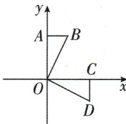

<!-- question-source:start -->
3[2025 四川自贡质检]如图, 在平面直角坐标系中, $D(4, -2)$ , 将 Rt $\triangle OCD$ 绕点 O 逆时针旋转 $90^{\circ}$ 到 $\triangle OAB$ 的位置, 则点 B 的坐标为
A. (2,4) B. (4,2)
C. (-4,-2) D. (-2,4)

<!-- question-source:end -->

![[Q00107110A1]]
