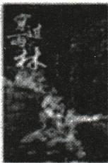

<!-- question-source:start -->
5 为落实教育部办公厅、中共中央宣传部办公厅关于《第41批向全国中小学生推荐优秀影片片目》的通知精神,某校七、八年级分别从如图

建议用时

100 分钟

所示的三部影片中随机选择一部组织本年级学生观看,则这两个年级选择的影片相同的概率为()

A. $\frac{1}{2}$ B. $\frac{1}{3}$ C. $\frac{1}{6}$ D. $\frac{1}{9}$
<!-- question-source:end -->

![[Q00107112A1]]
