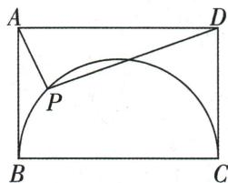

<!-- question-source:start -->
10 引理: 在 $\triangle ABC$ 中, 若 D 为 BC 的中点, 则

$AB^{2}+AC^{2}=2AD^{2}+2CD^{2}$ (中线长公式, 不用证明, 可以直接应用). 根据这个引理, 解决下面

的问题:如图,在矩形ABCD中,AB=6,BC=8,点P在以BC为直径的半圆上运动,则 $PA^{2}+PD^{2}$ 的最小值是() A. $2\sqrt{10}$ B.38 C.40 D.68
<!-- question-source:end -->

![[Q00107117A1]]
