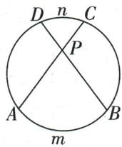

<!-- question-source:start -->
11[2025 江苏南京期中]如图,圆的两条弦 AC,BD 相交于点 P, $\widehat{AmB},\widehat{CnD}$ 的度数分别为 $\alpha,\beta$ , $\angle APB$ 的度数为 $\gamma$ , 则 $\alpha,\beta$ 和 $\gamma$ 之间的数量关系为 \_\_\_\_.

<!-- question-source:end -->

![[Q00107118A1]]
