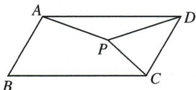

<!-- question-source:start -->
14[2023江西中考]如图,在 $\square ABCD$ 中, $\angle B=60^{\circ},BC=2AB$ ,将 $AB$ 绕点 $A$ 逆时针旋转角 $\alpha(0^{\circ}<\alpha<360^{\circ})$ 得到 $AP$ ,连接 $PC,PD$ .当 $\triangle PCD$ 为直角三角形时,旋转角 $\alpha$ 的度数为\_\_\_\_.

<!-- question-source:end -->

![[Q00107121A1]]
