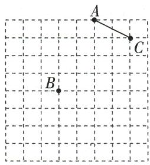
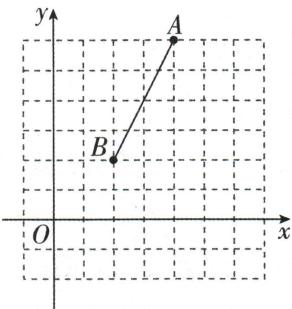

<!-- question-source:start -->
16(10分)[2025湖北武汉质检]如图,在8×8的正方形网格中,每个小正方形的边长都为1,A,B两点都在格点上,仅用无刻度的直尺在给定网格中按要求画图(不用写出作图步骤,画图过程用虚线表示,画图结果用实线表示).

图(1)
图(2)

(1)在图(1)中,C为格点.
①先将线段CA绕点C逆时针旋转90°得到线段CD,连接AD;
②再画线段EF,使线段EF与线段AD关于点B成中心对称(其中E点对应A点,F点对应D点);

(2)在图(2)中,以格点 O 为坐标原点建立平面直角坐标系,其中 B 点坐标为(2,2).
①先画格点 G,使 $OG \perp AB$ ,且 OG = AB;
②已知线段 AB 绕平面内的点 P 旋转一个特定的度数可与线段 GO 重合(点 A 与点 G 重合,点 B 与点 O 重合),请在图中画出旋转中心 P;
③请直接写出 P 点的坐标为 \_\_\_\_.
<!-- question-source:end -->

![[Q00107123A1]]
