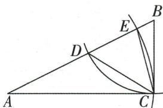

<!-- question-source:start -->
19(13分)[2025山东淄博期中]如图,在 $\triangle ABC$ 中, $\angle ACB=90^{\circ}$ ,以点 $B$ 为圆心, $BC$ 长为半径画弧,交边 $AB$ 于点 $D$ ,连接 $CD$ .以点 $A$ 为圆心, $AC$ 长为半径画弧,交边 $AB$ 于点 $E$ ,连接 $CE$ .
(1)求 $\angle DCE$ 的度数.
(2)设 $BC=a,AC=b$ .
①边 $BE$ 的长是关于 $x$ 的方程 $x^{2}+2bx-a^{2}=0$ 的一个根吗?说明理由.
②若 $D$ 为 $AE$ 的中点,求 $\frac{a}{b}$ 的值.

<!-- question-source:end -->

![[Q00107125A1]]
