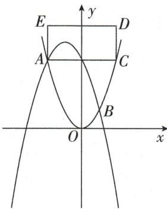
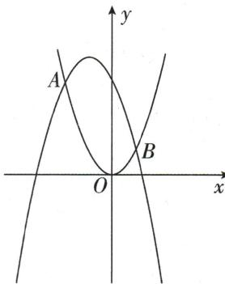

<!-- question-source:start -->
20(14分)如图,在平面直角坐标系中,抛物线 $C_{1}:y=x^{2}$ 上有两点A,B,其中点A的横坐标为-2,点B的横坐标为1,抛物线 $C_{2}:y=-x^{2}+bx+c$ 过点A,B,过A作 $AC//x$ 轴交抛物线 $C_{1}$ 另一点为点C.以AC, $\frac{1}{2}AC$ 长为边向上构造矩形ACDE.
(1)求抛物线 $C_{2}$ 的解析式.
(2)将矩形ACDE向左平移m个单位,向下平移n个单位得到矩形 $A^{\prime}C^{\prime}D^{\prime}E^{\prime}$ ,点C的对应点 $C^{\prime}$ 落在抛物线 $C_{1}$ 上.
①求n关于m的函数关系式,并直接写出自变量m的取值范围;
②直线 $A^{\prime}E^{\prime}$ 交抛物线 $C_{1}$ 于点P,交抛物线 $C_{2}$ 于点Q.当点 $E^{\prime}$ 为线段PQ的中点时,求m的值;
③抛物线 $C_{2}$ 与边 $E^{\prime}D^{\prime},A^{\prime}C^{\prime}$ 分别相交于点M,N,点M,N在抛物线 $C_{2}$ 的对称轴同侧,当 $MN=\frac{2\sqrt{10}}{3}$ 时,求点 $C^{\prime}$ 的坐标.

备用图

<!-- question-source:end -->

![[Q00107126A1]]
