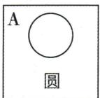
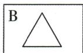
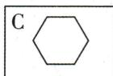
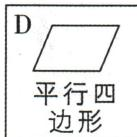

<!-- question-source:start -->
17(12分)[2024云南昆明期中]有四张反面完全相同的纸牌A、B、C、D,其正面分别画有四个不同的几何图形(如图所示),将四张纸牌洗匀正面朝下随机放在桌面上.

(1)从四张纸牌中随机摸出一张,摸出的纸牌正面所画图形是中心对称图形的概率是\_\_\_\_.

(2) 小明和小亮约定做一个游戏, 其规则为先由小明随机摸出一张纸牌, 不放回. 再由小亮从剩下的纸牌中随机摸出一张, 若摸出的两张纸牌正面所画图形均既是轴对称图形又是中心对称图形, 则小亮获胜, 否则小明获胜. 这个游戏公平吗? 请用列表法 (或画树状图法) 说明理由. (纸牌用 A、B、C、D 表示) 若不初中必刷题 数学九年级上册 RJ

公平,请你帮忙修改游戏规则,使游戏公平.

正三角形

正六边形

<!-- question-source:end -->

![[Q00107280A1]]
