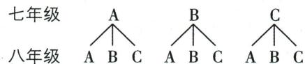

> [!success]- 必刷题
>
> > [!success] **【答案】** B
>
> > [!note]- **【解析】**
> > 用 A, B, C 分别代表三部影片, 画树状图如下:
> >
> > 
> >
> > 由图可知,共有9种等可能的情况,其中两个年级选择影片相同的情况有3种,所以两个年级选择影片相同的概率是 $\frac{3}{9}=\frac{1}{3}$ .
> >
> > 故选 **B**.
