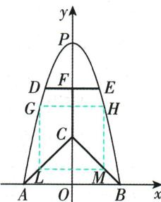

> [!success]- 必刷题
>
> > [!success] **【答案】** C
>
> > [!note]- **【解析】**
> > 设直线 MN 的解析式为 $y = kx + b (k \neq 0)$ , $\therefore\left\{\begin{aligned}k+b=2,\\3k+b=-3,\end{aligned}\right.$ 解得 $\left\{\begin{aligned}k&=-\frac{5}{2},\\ b&=\frac{9}{2},\end{aligned}\right.$ $\therefore y=-\frac{5}{2}x+\frac{9}{2}$ ，当 x=3如图(2)，矩形灯带为GHML.由点 $A(-3,0),B(3,0),C(0,3)$ 得，直线 $AC$ 和 $BC$
> >
> > 的解析式分别为 $y = x + 3, y = -x + 3$ . 设点 $G(t, -t^{2} + 9)$ , $H(-t, -t^{2} + 9)$ , $L(t, t + 3)$ , $M(-t, t + 3)$ , 则矩形 GHML 的周长为 $2(GH + GL) = 2(-2t - t^{2} + 9 - t - 3) = -2(t + 1.5)^{2} + \frac{33}{2}$ .
> > 故矩形周长的最大值为 $\frac{33}{2}$ 米.
> >
> > 
> > 图(2)
> >
> > 时， $y=-3\neq5$ ；当x=-3时， $y=12\neq5$ ；当x=-1时，y=7；当x=1时， $y=2\neq-3$ ，∴点 $(-1,7)$ 在直线MN上，∴ $M(1,2)$ ， $N(3,-3)$ ， $P(-1,7)$ 不能确定一个圆.
> >
> > 故选 **C**.
