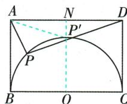

> [!success]- 必刷题
>
> > [!success] **【答案】** C
>
> > [!note]- **【解析】**
> > 如图, 设点 N 为 AD 的中点, 点 O 为 BC 的中点, 连接 ON 交半圆于点 $P'$ , 此时 PN 取最小值, 即 $P'N$ . ∵ BC 是直
> >
> > 
> >
> > 径，O 是 BC 的中点，BC=8，∴ $OP' = OC = \frac{1}{2} BC = 4$ .
> > ∵ 四边形 ABCD 为矩形，∴ AD∥BC, AD = BC,
> > ∴ AN = BO, ∴ 四边形 ANOB 为平行四边形.
> > 又∵∠ABC=90°, ∴ 四边形 ABON 为矩形,
> > ∴ ON=AB=6, AN=ND=4, PN=P'N=ON-OP'=6-
> > 4=2. ∵ PA²+PD²=2PN²+2ND², DN=4 不变, ∴ 当
> > PN 取最小值时, PA²+PD² 取得最小值, 此时 PA²+
> > PD²=2×2²+2×4²=40.
> >
> > 故选 **C**.
