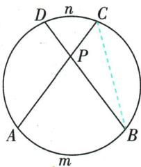

> [!success]- 必刷题
>
> > [!success] **【答案】** $\gamma = \frac{1}{2} (\alpha +\beta)
>
> > [!note]- **【解析】**
> > 如图，连接 $BC.\because \angle ACB = \frac{1}{2}\alpha ,\angle DBC =$ $\frac{1}{2}\beta ,\angle APB = \angle ACB + \angle DBC,$ $\therefore \gamma = \frac{1}{2} (\alpha +\beta)$ ，故答案为 $\gamma = \frac{1}{2} (\alpha +\beta).$
> >
> > 
