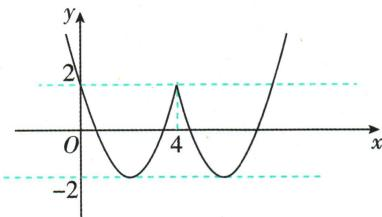

> [!success]- 必刷题
>
> > [!success] **【答案】** 2
>
> > [!note]- **【解析】**
> > 函数 $y = \begin{cases} (x - 2)^2 - 2 (x \leqslant 4), \\ (x - 6)^2 - 2 (x > 4) \end{cases}$ 的图象如图所示.
> >
> > 
> >
> > 根据图象可知, 当 y=2 时, 对应的 x 的值恰好有 3 个, ∴ a=2. 故答案为 2.
