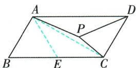
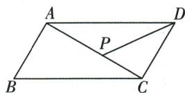
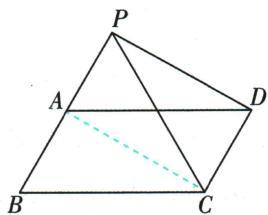
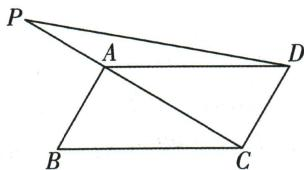

> [!success]- 必刷题
>
> > [!success] **【答案】** $90^{\circ}$ 或 $180^{\circ}$ 或 $270^{\circ}$
>
> > [!note]- **【解析】**
> > 连接 AC，取 BC 的中点 E，连接 AE，如图(1)所示.
> > 在□ABCD 中， $\angle B=60^{\circ}, BC=2AB, AB\parallel CD, AB=CD, \therefore BE=\frac{1}{2}BC=AB, \therefore \triangle ABE$ 是等边三角形， $\therefore \angle BAE = \angle AEB = 60^{\circ}, AE = BE = EC,$ $\therefore \angle EAC = \angle ECA = \frac{1}{2} \angle AEB = 30^{\circ},$ $\therefore \angle BAC = 90^{\circ}, \therefore \angle ACD = 90^{\circ}.$
> >
> > 
> > 图(1)
> >
> > 
> > 图(2)
> >
> > 如图(2)所示, 当点 P 在 AC 上时, $\angle BAP = 90^{\circ}$ , 则旋转角 $\alpha$ 的度数为 $90^{\circ}$ , 此时 $\angle DCP = 90^{\circ}$ ,
> > ∴ $\triangle PCD$ 为直角三角形.
> > 当点 P 在 BA 的延长线上时, 旋转角 $\alpha$ 的度数为 $180^{\circ}$ , 如图(3)所示, 连接 AC. ∵ PA = AB = CD, PA // CD, ∴ 四边形 PACD 是平行四边形. ∵ $\angle BAC = 90^{\circ}$ , ∴ $\angle PAC = 90^{\circ}$ , ∴ 四边形 PACD 是矩形,
> > ∴ $\angle CDP = 90^{\circ}$ , ∴ $\triangle PCD$ 是直角三角形.
> > 当点 P 在 CA 的延长线上时, 如图(4)所示, 则 $\alpha=$
> >
> > $360^{\circ} - 90^{\circ} = 270^{\circ}, \angle PCD = 90^{\circ},$ $\therefore \triangle PCD$ 是直角三角形.
> >
> > 
> > 图(3)
> >
> > 
> > 图(4)
> >
> > 综上所述,旋转角 $\alpha$ 的度数为 $90^{\circ}$ 或 $180^{\circ}$ 或 $270^{\circ}$ .
> > 故答案为 $90^{\circ}$ 或 $180^{\circ}$ 或 $270^{\circ}$ .
