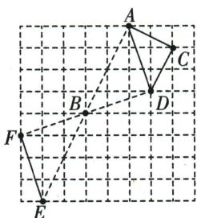
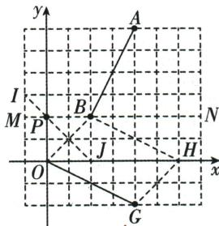

> [!success]- 必刷题
>
> > [!success] **【答案】** (0,2)
>
> > [!note]- **【解析】**
> > 【解】(1)①如图(1),线段 CD,AD 即为所求.
> > - **②**：如图(1),线段 EF 即为所求.
> >
> > 
> >
> > 
> > 图(1)
> > 图(2)
> > (2)①如图(2)，点G为所求.
> > - **②**：如图(2)，点P为所求.
> > - **③**：由图(2)可得，点P的坐标为(0,2). 故答案为(0,2).
