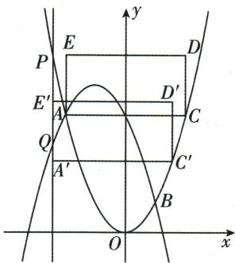
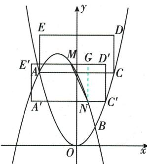

> [!success]- 必刷题
>
> > [!success] **【答案】** A
>
> > [!note]- **【解析】**
> > 【解】(1)∵A,B两点在抛物线 $C_{1}:y=x^{2}$ 上，点A的横坐标为-2，点B的横坐标为1，
> > ∴当x=-2时, $y=(-2)^{2}=4$ ，即 $A(-2,4)$ ，
> > 当x=1时,y=1,即 $B(1,1)$ .
> > 将点 $A(-2,4)$ , $B(1,1)$ 代入抛物线 $C_{2}:y=-x^{2}+bx+c$ ，得 $\left\{\begin{aligned}-(-2)^{2}-2b+c&=4\\ -1+b+c&=1\end{aligned}\right.$ ，解得 $\left\{\begin{aligned}b&=-2\\ c&=4\end{aligned}\right.$ ∴抛物线 $C_{2}$ 的解析式为 $y=-x^{2}-2x+4$ .
> >
> > (2)①∵ $AC \parallel x$ 轴交抛物线 $C_{1}: y = x^{2}$ 另一点为点 C，当 y = 4 时， $x = \pm 2, \therefore C(2, 4)$ . ∵ 矩形 ACDE 向左平移 m 个单位，向下平移 n 个单位得到矩形 $A'C'D'E'$ ，点 C 的对应点 $C'$ 落在抛物线 $C_{1}$ 上，∴ $C'(2 - m, 4 - n), (2 - m)^{2} = 4 - n$ ，整理得 $n = -m^{2} + 4m$ .
> > ∵ m > 0, n > 0, ∴ 0 < m < 4, ∴ $n = -m^{2} + 4m (0 < m < 4)$ .
> > - **②**：如图（1）. ∵ A(-2,4), C(2,4), ∴ AC = 4,
> > ∴ AE = $\frac{1}{2}$ AC = 2, ∴ E(-2,6).
> > 由①可得 $A'(-2-m, m^{2}-4m+4)$ , $E'(-2-m, m^{2}-4m+6)$ , ∴ P, Q 的横坐标为 -2 - m，将其分别代入 $C_{1}, C_{2}$ ，则 $P(-2-m, m^{2}+4m+4)$ , $Q(-2-m, -m^{2}-2m+4)$ , ∴ $\frac{m^{2}+4m+4-m^{2}-2m+4}{2}=m+4$ ,
> > ∴ PQ 的中点坐标为 $(-2-m, m+4)$ .
> > ∵ 点 $E'$ 为线段 PQ 的中点，∴ $m^{2}-4m+6=m+4$ 解得 $m=\frac{5-\sqrt{17}}{2}$ 或 $m=\frac{5+\sqrt{17}}{2}$ （不符合题意，舍去），∴ m 的值为 $\frac{5-\sqrt{17}}{2}$ .
> >
> > 
> >
> > 
> > 图(1)
> > 图(2)
> > - **③**：如图(2)，过点 $N$ 作 $NG \perp E' D'$ 于点 $G$ ，则 $NG = 2$ . $\because MN = \frac{2\sqrt{10}}{3}$ ， $\angle NGM = 90^\circ$ ， $\therefore MG = \sqrt{MN^2 - NG^2} = \frac{2}{3}$ . 设 $N(a, -a^2 - 2a + 4)$ ，则 $M(a - \frac{2}{3}, -a^2 - 2a + 6)$ . 将 $M$ 点代入 $y = -x^2 - 2x + 4$ ，得 $-\left(a - \frac{2}{3}\right)^2 - 2 \times \left(a - \frac{2}{3}\right) + 4 = -a^2 - 2a + 6$ ，解得 $a = \frac{5}{6}$ . 当 $a = \frac{5}{6}$ 时， $-a^2 - 2a + 4 = -\left(\frac{5}{6}\right)^2 - 2 \times \frac{5}{6} + 4 = \frac{59}{36}$ ， $\therefore N\left(\frac{5}{6}, \frac{59}{36}\right)$ . 将 $y = \frac{59}{36}$ 代入 $y = x^2$ ，解得 $x_1 = \frac{\sqrt{59}}{6}$ ， $x_2 = -\frac{\sqrt{59}}{6}$ ， $\therefore C'$ 的坐标为 $\left(\frac{\sqrt{59}}{6}, \frac{59}{36}\right)$ 或 $\left(-\frac{\sqrt{59}}{6}, \frac{59}{36}\right)$ .
> >
> > 
> >
> > 其实人跟树是一样的
> > 越是向往高处的阳光
> > 它的根就越要伸向黑暗的地底
> > 所以那些黑夜里你默默刷的每一道题
> > 都是为了更快缩短与光的距离
> >
> > 您在使用本书时若有问题需要反馈，请及时与我们联系。经核实后，您发现的问题或所提的建议确实对优化本书内容有益，我们将为您提供相应奖励。
> >
> > 
> >
> > 扫码反馈有礼或拨打客服电话400-688-9167
