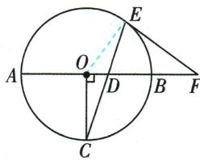

> [!success]- 必刷题
>
> > [!success] **【答案】** (1)
>
> > [!note]- **【解析】**
> > 【证明】如图,连接OE.∵ $\angle OCE.\because DF=FE,\therefore\angle FED=$ $\angle FDE.\because\angle FDE=\angle CDO,$ $\angle CDO + \angle OCD = 90^{\circ},$ $\therefore \angle FED + \angle OEC = 90^{\circ}$ ，即 $\angle FEO = 90^{\circ}, \therefore OE \perp FE.$ ∵ OE 是 $\odot O$ 的半径，∴ EF 为
> >
> > 
> >
> > $$
> > \odot 0
> > $$
> >
> > (2)【解】设 $\odot O$ 的半径为 $r$ , 则 $EO = BO = r$ , $\therefore BD = BF = r - 1$ , $\therefore OF = r + r - 1 = 2r - 1$ , $FE = FD = 2BD = 2r - 2$ . 在 Rt $\triangle FEO$ 中, 由勾股定理得 $FE^2 + OE^2 = OF^2$ , $\therefore (2r - 2)^2 + r^2 = (2r - 1)^2$ , 解得 $r = 3$ 或 $r = 1$ (舍去), $\therefore \odot O$ 的半径为 3.
