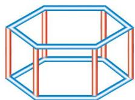

# 第2题 · 一个六棱柱框架如图所示, 它的底面边长都是 5 {~cm} , 侧棱长 4 {~cm} 。观察这个框架,

2. 一个六棱柱框架如图所示, 它的底面边长都是 $5 \mathrm{~cm}$ , 侧棱长 $4 \mathrm{~cm}$ 。观察这个框架, 回答下列问题:

(1) 这个六棱柱的几个面分别是什么形状？哪些面的形状、大小完全相同？

(2) 这个六棱柱所有侧面的面积之和是多少?

  
(第2题)

  
(第3题)

