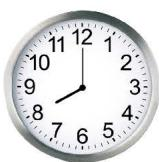
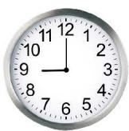
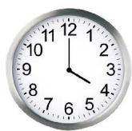
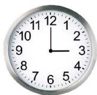
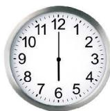

# 第27题 · 下面的五个时钟显示了同一时刻国外四个城市时间和北京时间，根据下表给出的国外四个城市与北京的时差，请分别

※27. 下面的五个时钟显示了同一时刻国外四个城市时间和北京时间，根据下表给出的国外四个城市与北京的时差，请分别在时钟下标明五个城市的名称。

<table><tr><td>城市</td><td>时差 /h</td></tr><tr><td>纽约</td><td>-13</td></tr><tr><td>悉尼</td><td>+2</td></tr><tr><td>伦敦</td><td>-8</td></tr><tr><td>罗马</td><td>-7</td></tr></table>

  
(第27题)

