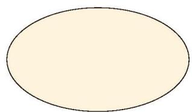
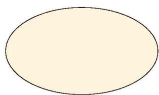
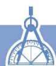

# 第1题 · 将下列代数式中的单项式和多项式分别填入所属的圈中，并指出其中：各单项式的系数分别是多少？多项式中哪个次数

1. 将下列代数式中的单项式和多项式分别填入所属的圈中，并指出其中：各单项式的系数分别是多少？多项式中哪个次数最高？次数是多少？

$$
- 1 5 a ^ {2} b, \frac {3 x ^ {2}}{\pi}, 2 x - 3 y, 4 a ^ {2} b ^ {2} - 4 a b + b ^ {2}, - a, x ^ {3} + 2 y - x _ {\circ}
$$

  
单项式

  
多项式

