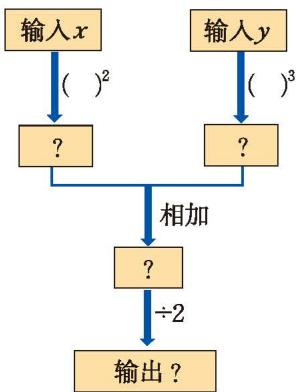

# 第7题 · 下图是一个“数值转换机”的示意图，写出运算过程并填写下表。

7. 下图是一个“数值转换机”的示意图，写出运算过程并填写下表。

  
(第7题)

<table><tr><td>x</td><td>-1</td><td>0</td><td>1</td><td>2</td></tr><tr><td>y</td><td>1</td><td>-0.5</td><td>0</td><td>0.5</td></tr><tr><td>输出</td><td></td><td></td><td></td><td></td></tr></table>
