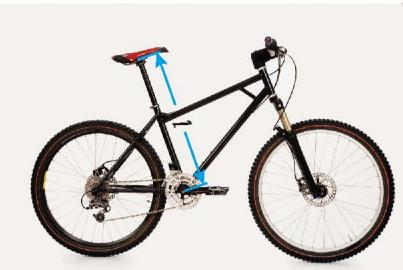

# 第16题 · 骑山地自行车过程中, 如果车座高度不合适, 会使骑行者踩踏费力, 甚至造成膝盖磨损。如何确定合适的车座

16. 骑山地自行车过程中, 如果车座高度不合适, 会使骑行者踩踏费力, 甚至造成膝盖磨损。如何确定合适的车座高度呢? 有一种雷蒙德 (Lemond) 测量方法: 双腿站立, 两脚 (不穿鞋) 间距约 $15 \mathrm{~cm}$ , 测量裆部离地面的高度 $h$ (单位: $\mathrm{cm}$ ), 得出的数据乘 0.883 就是相应的车座顶部到中轴的距离 $l$ (如图, 单位: $\mathrm{cm}$ ), 此时的车座高度是骑行最合适的高度。根据雷蒙德测量方法解决下列问题:

(1) 用含 $h$ 的代数式表示 $l$ 。

(2) 当 $h = 84 \mathrm{~cm}$ 时, $l$ 为多少厘米?

(3) 请测量自身的相关数据, 计算并调整自己山地自行车的车座高度, 检验雷蒙德测量方法是否适合自己。

  
(第16题)
