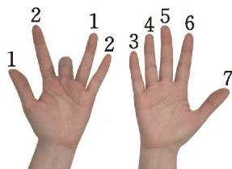

# 第12题 · 对于 3 9 = 27 , 可以用 10 个手指直观地展示出来－ 如图, 将两手平伸, 手心向上, 从

※12. 对于 $3 \times 9 = 27$ , 可以用 10 个手指直观地展示出来: 如图, 将两手平伸, 手心向上, 从左边开始数至第 3 个手指, 将它弯起, 此时它的左边有 2 个手指, 右边有 7 个手指, “27”正是“ $3 \times 9$ ”的结果。类似地, $1 \times 9 = 9$ , $2 \times 9 = 18$ , $4 \times 9 = 36$ , ……, $9 \times 9 = 81$ 也可以用手指直观地展示出来。请用本章学过的知识解释其中的道理。

  
$3 \times 9 = 27$  
(第12题)
