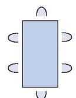
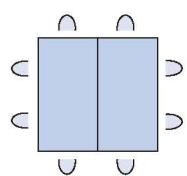
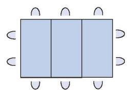
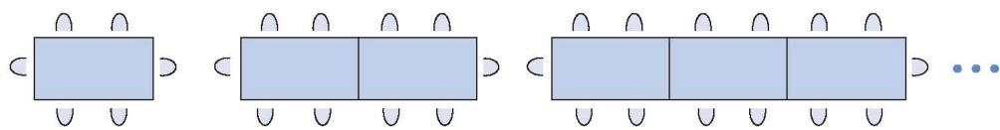

# 第1题 · 某学校食堂的餐桌椅有两种摆放方式。

1. 某学校食堂的餐桌椅有两种摆放方式。

(1) 按下图方式摆放餐桌和椅子, 照这样的方式继续排列餐桌, 摆 4 张桌子可坐多少人? 摆 5 张桌子呢? 摆 $n$ 张桌子呢?

  
[第1(1)题]

(2) 按下图方式摆放餐桌和椅子, 照这样的方式继续排列餐桌, 摆 4 张桌子可坐多少人? 摆 5 张桌子呢? 摆 $n$ 张桌子呢?

  
[第1(2)题]

(3) 在食堂就餐的高峰时段, 要求同时能坐下 300 人, 上面哪种方式所需要的餐桌数较少?
