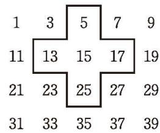

# 第2题 · 将连续的奇数 1, 3, 5, 7, 9, … 排成如图所示的数表。

2. 将连续的奇数 1, 3, 5, 7, 9, … 排成如图所示的数表。

(1) 十字形框中的五个数之和与中间数 15 有什么关系?

(2) 设中间数为 $a$ , 如何用代数式表示十字形框中五个数之和?

  
(第2题)

(3) 若将十字形框上下左右移动, 可框住另外五个数,这五个数还有上述的规律吗?

(4) 十字形框中的五个数之和能等于 2022 吗? 能等于 2025 吗?
