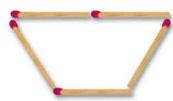
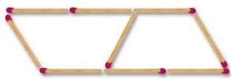
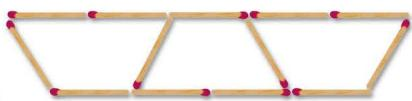

# 第17题 · 用长度相同的小棒按下图中的方式拼摆图形。

17. 用长度相同的小棒按下图中的方式拼摆图形。

①

②

③

(第17题)  
(1) 按图示规律填空;

<table><tr><td>图形标号</td><td>1</td><td>2</td><td>3</td><td>4</td><td>5</td></tr><tr><td>小棒数量/根</td><td></td><td></td><td></td><td></td><td></td></tr></table>

(2) 按照这种方式拼摆下去, 第 $n$ 个图形需要\_\_\_\_根小棒。
