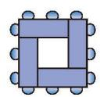
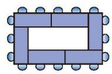
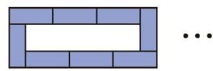

# 第19题 · 某会议中心购买了一批长方形会议桌，每张会议桌的长边可以坐2个人，短边只能坐1个人。按照如图所示的规律拼

19. 某会议中心购买了一批长方形会议桌，每张会议桌的长边可以坐2个人，短边只能坐1个人。按照如图所示的规律拼摆会议桌，能够得到不同型号的大桌子。

  
型号1

  
型号2

  
型号3  
(第19题)

(1) 型号 3 的大桌子可以坐多少人?

(2)型号 $n$ 的大桌子可以坐多少人？

(3) 如果有 36 人参会, 那么哪个型号的大桌子恰好可以坐下? 请说明理由。
