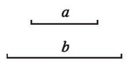
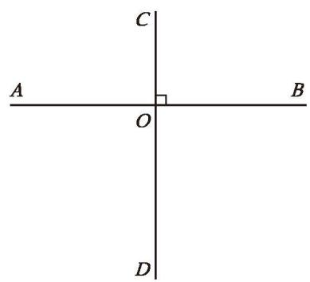
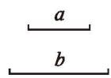

# 第2题 · 如图, 已知线段 a 和 b , 直线 A B 和 C D 相交于点 O 。请用尺规按下列要求作图 ①－

2. 如图, 已知线段 $a$ 和 $b$ , 直线 $A B$ 和 $C D$ 相交于点 $O$ 。请用尺规按下列要求作图 ①:

(1) 在射线 $OA, OB, OC$ 上作线段 $OA', OB', OC'$ , 使它们分别与线段 $a$ 相等;

(2) 在射线 $OD$ 上作线段 $OD'$ , 使 $OD'$ 与线段 $b$ 相等;

(3) 连接 $A^{\prime} C^{\prime}, C^{\prime} B^{\prime}, B^{\prime} D^{\prime}, D^{\prime} A^{\prime}$ 。

你得到了一个怎样的图形？与同伴进行交流。

  
(第2题)

(第3题)
