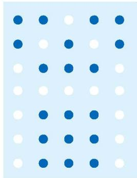

# 第7题 · 点和线段在生活中有着广泛的应用。

7. 点和线段在生活中有着广泛的应用。

(1) 如图 (1), 用 7 根长度相同的小棒可以摆出图中的 “8”。你能去掉其中的若干小棒, 摆出其他的 9 个数字吗? 这种用 7 条线段构成的数字称为 “7 画字”, 它可以用在计算器或电梯的楼层显示屏上。

(1)

  
(2)  
(第7题)

(2) 点也可以用来构成数字或符号, 点阵式打印机就是利用了这个原理。如图 (2), 在长方形点阵中, 白色的点就构成了英文字母 “A”。试利用这种方法做出其他 25 个英文字母。

(3) 试用点阵显示的方式在纸上做出“强国有我”这四个字。

